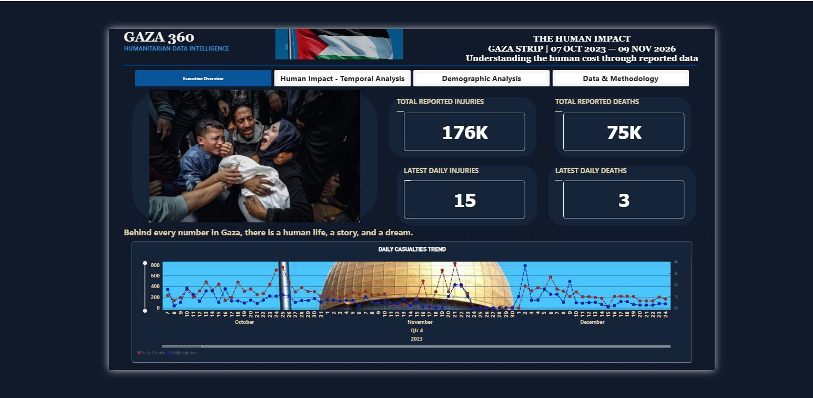
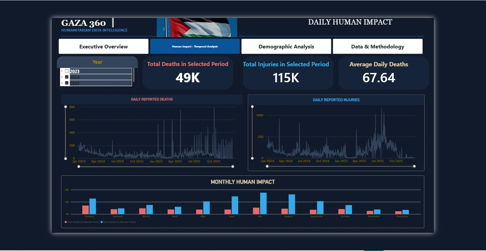
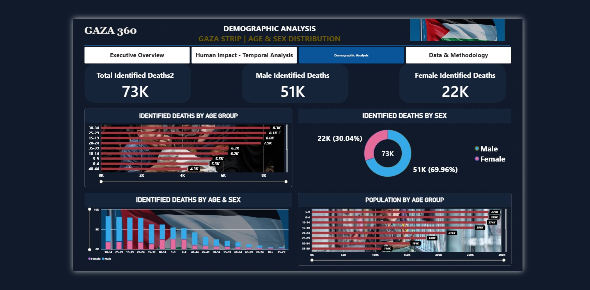
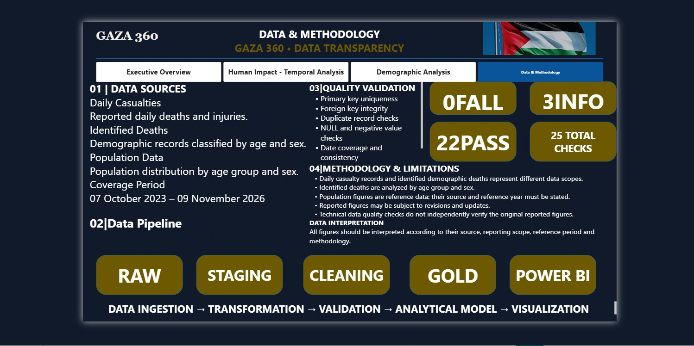

# GAZA 360
## Humanitarian Data Intelligence Platform

An end-to-end Data Engineering and Business Intelligence project designed to organize, transform, analyze, and visualize humanitarian data related to Gaza.

---

## Project Overview

GAZA 360 transforms raw humanitarian datasets into structured analytical data and interactive Power BI dashboards.

The project focuses on:
- Daily casualties analysis.
- Identified deaths by age and sex.
- Demographic and population analysis.
- Data quality and methodology documentation.
- Interactive reporting and trend analysis.

## Architecture

```text
Data Sources
     |
     v
  BRONZE
  Raw Data
     |
     v
  SILVER
  Cleaning & Transformation
     |
     v
   GOLD
  Analytical Data Model
     |
     v
  POWER BI
  Interactive Dashboards
```

## Technology Stack

| Technology | Purpose |
|---|---|
| SQL Server 2022 | Database and data transformation |
| SQL | Data extraction, cleaning and modeling |
| Python | Data collection and processing |
| Power BI | Data modeling and visualization |
| Git & GitHub | Version control and documentation |

## Data Model

The Gold layer contains 11 analytical tables:

- Fact tables:
  - fact_daily_casualties
  - fact_identified_deaths
  - fact_population

- Dimension tables:
  - dim_date
  - dim_age
  - dim_age_band
  - dim_sex
  - dim_update_batch

- Summary tables:
  - age_sex_summary
  - monthly_summary
  - rates_by_age_sex

The database also includes Bronze and Silver layers for raw and transformed data.

## Power BI Dashboard

The dashboard contains four analytical pages.

### 1. Executive Overview


### 2. Temporal Analysis


### 3. Demographic Analysis


### 4. Data & Methodology


## Repository Structure

```text
GAZA-360/
|
|-- data/
|-- documentation/
|-- notebooks/
|-- power_bi/
|   |-- screenshots/
|
|-- python/
|   |-- cleaning/
|   |-- data_collection/
|
|-- sql/
|   |-- 00_setup/
|   |-- 01_bronze/
|   |-- 02_silver/
|   |-- 03_gold/
|   |-- 04_validation/
|   |-- 01_database/
|
|-- README.md
|-- requirements.txt
```

## Data Quality & Methodology

The project includes technical data quality checks and documentation of transformation rules.

Important considerations:
- Source datasets may have different reporting scopes.
- Demographic records may represent periodic update snapshots.
- Population figures require their reference year and methodology to be considered.
- Technical validation does not independently verify the underlying reported figures.

## Project Limitations

- Data completeness depends on the available source datasets.
- Historical records may be revised by their original publishers.
- Some demographic measures are subject to snapshot and reporting limitations.
- Further source verification and automated pipeline orchestration are planned.

## Future Improvements

- Automate data ingestion and refresh.
- Expand data quality monitoring.
- Improve pipeline orchestration.
- Add further analytical insights.
- Publish the Power BI report and project documentation.

## Author

**Abdelrahman Osama Ramadan**

Data Analysis | Data Engineering | Business Intelligence

---

*This project is developed for educational, analytical, and portfolio purposes.*
